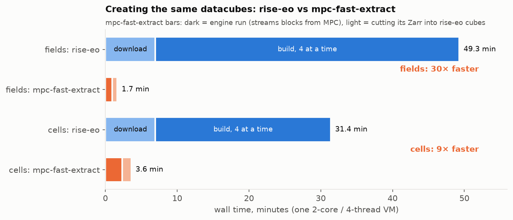
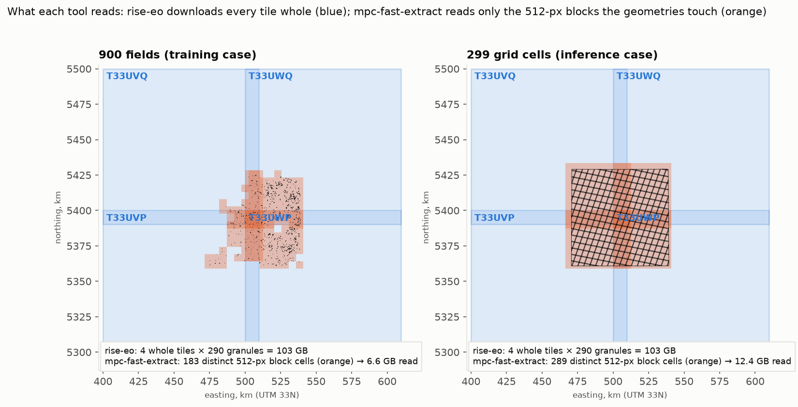
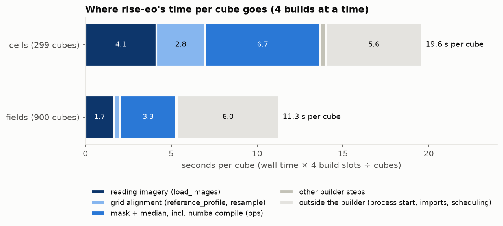
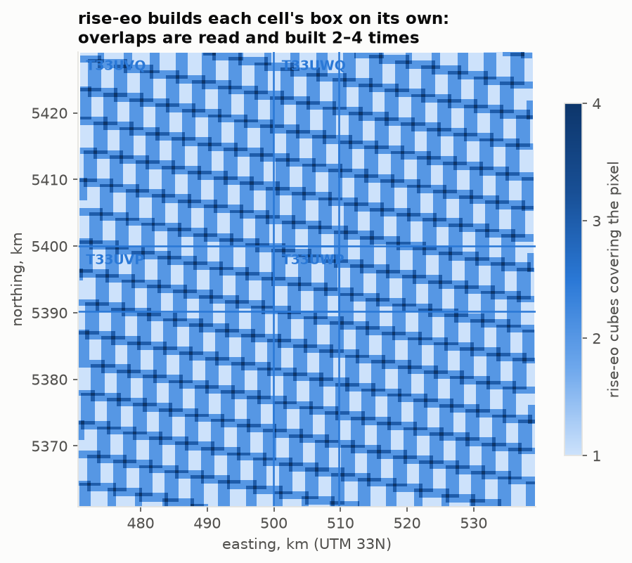
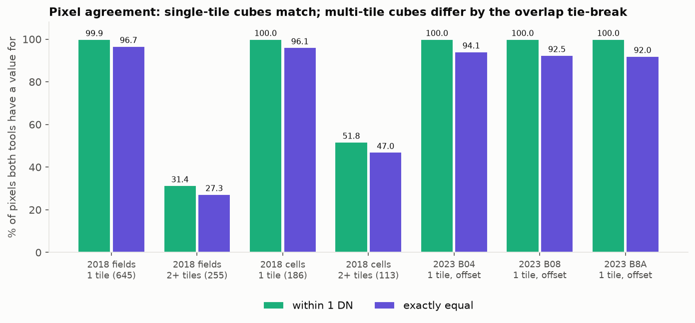
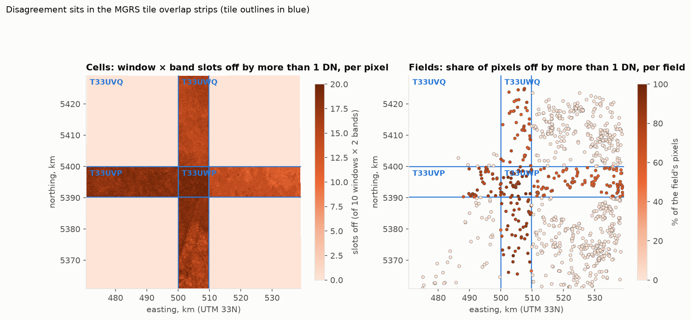
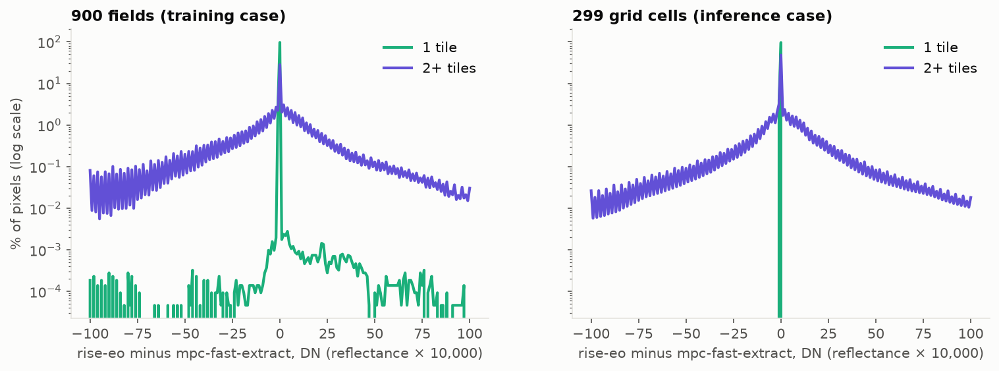

# Finding — mpc-fast-extract builds rise-eo's datacubes 9–30× faster

**Measured:** 2026-10-20 to 2026-10-23, with run-book
[`198-p0-mpc-fast-extract-parity.ipynb`](../../runbooks/198-p0-mpc-fast-extract-parity.ipynb).
**Tracking issue:** [#198](https://github.com/nasaharvest/rise-eo/issues/198). PR:
[#199](https://github.com/nasaharvest/rise-eo/pull/199).
**Versions:** rise-eo `12c7b90` (the run-book branch), mpc-fast-extract `da6bf12`
([rohansaw/mpc-fast-extract](https://github.com/rohansaw/mpc-fast-extract), MIT).

> Point-in-time. These numbers were true of these two versions, this machine and this imagery on the
> dates above. A later measurement goes into a new finding.

## The headline

*Figure 1. Wall time to create the same datacubes, per tool and workload.*

- **mpc-fast-extract created the same datacubes 30× faster for 900 small field cubes, and 9× faster for
  299 large grid cells**, counting rise-eo's download. Counting only rise-eo's build (as if the archive
  were already on disk), it was 25× and 7× faster.
- **It read 8–16× fewer bytes:** 6.6 GB and 12.4 GB, against rise-eo's 102.7 GB archive.
- **Where one MGRS tile supplies the pixels, the cubes are the same:** 99.94–100 % of pixels agree within
  1 DN. Where two tiles overlap, the tools fill the overlap from different (equally valid) products of the
  same overpass, so those pixels differ by a few DN.
- **The −1000 DN radiometric offset of newer imagery, and resampling a 20 m band to 10 m, behave the same
  in both tools** (a separate check on June 2023 imagery).
- **The run also found four problems in rise-eo** that have nothing to do with mpc-fast-extract
  ([#200](https://github.com/nasaharvest/rise-eo/issues/200),
  [#201](https://github.com/nasaharvest/rise-eo/issues/201),
  [#202](https://github.com/nasaharvest/rise-eo/issues/202),
  [#203](https://github.com/nasaharvest/rise-eo/issues/203)).

## What was compared

**The two tools.** rise-eo downloads whole Sentinel-2 granules (one file per band per MGRS tile, about
110 km square) into an archive, then builds one cube per geometry: it reads each granule's window,
masks clouds with SCL, and takes a median per calendar window. mpc-fast-extract never downloads: it reads
only the 512 × 512-pixel blocks of each file that the geometries touch, straight from Microsoft Planetary
Computer (MPC), reads SCL first so fully cloudy blocks are skipped, and composites everything in one pass.
Here it wrote one Zarr per workload, which the run-book then cut into rise-eo-format cubes.

**The machine.** One Azure ML compute instance, Standard_E4ds_v4, in West Europe (the region MPC's
imagery is stored in): 4 vCPUs on **2 physical cores** (2 threads per core), 32 GB RAM, USD 0.35 per hour.
Both tools ran on it alone, one after the other.

**The workloads.** Sentinel-2 L2A from MPC, 2018-04-01 to 2018-09-30, bands B04 and B08 (SCL for the
mask), 20-day windows (10 windows), all in UTM zone 33N:

| workload | geometries | cube size | what it stands for |
|---|---|---|---|
| fields | the 900 EuroCrops fields of `AT_2018_TRAIN` | median 16 × 15 px | training data |
| cells | `AT_ROI` cut into 299 grid cells | median 555 × 598 px | inference |

**Settings matched on purpose** so that any difference would be a real one:

| setting | rise-eo | mpc-fast-extract |
|---|---|---|
| windows | calendar windows of 20 days from 2018-04-01 | `period: 20d`, end date 2018-09-30 (its end is inclusive) |
| composite | median | `composite: median` |
| one day's overlapping granules | first valid one fills the pixel | `fuse: first_valid` |
| cloud mask | rise-eo's SCL classes 0, 1, 3, 7, 8, 9, 10 | the same list in `scl_mask` |
| scenes dropped for cloud cover | none | `max_scene_cloud_cover: 100` |
| pixels on a polygon's edge | all touched | `all_touched: true` |
| grid | UTM 33N, 10 m, on the MGRS pixel lattice | `grid: {crs: EPSG:32633, resolution: 10}` |
| resampling | nearest | nearest (the default) |
| output | uint16 DN, offset applied, nodata 0 | float32 reflectance, × 10,000 and rounded when cut into cubes |

**How the Zarr becomes cubes.** mpc-fast-extract writes one Zarr array `data`, shaped
`(time, band, y, x)`, on the configured grid (here UTM 33N at 10 m, one time slot per 20-day window).
- **Its extent is whole work tiles, not the geometries.** The engine snaps the geometries' extent to work
  tiles of 10,240 × 10,240 px (about 102 km at 10 m), whose origins sit at multiples of 102.4 km.
  - The fields span about 64 × 65 km, but their Zarr is 1 × 2 work tiles (102 × 205 km), because they
    straddle a tile edge.
  - The cells span about 68 × 68 km; their Zarr is 2 × 2 work tiles (205 × 205 km).
- **It is mostly empty.** It is stored per work tile and window, and inside that per 512 × 512 block.
  Blocks no geometry touches are never written, and read back as nodata. Both Zarrs together took 5.4 GB
  on disk. Loaded whole, though, the cells Zarr would be about 34 GB of float32, so it has to be read
  lazily.
- **The engine clips to the union of the geometries only:** a pixel outside every geometry is nodata. It
  writes no per-geometry cubes.
- **The run-book does the cutting** (Step 7). For each geometry it reads the geometry's bounding box from
  the Zarr, sets pixels outside the geometry to 0 (keeping touched pixels, as rise-eo does), converts
  reflectance to rise-eo's uint16 DN (× 10,000), and saves `datacube.npy` with its metadata. Where two
  cells overlap, this step decides which cube a pixel goes into.

**The median does not depend on the geometry.** Both tools take the median per pixel, over that pixel's
own clear observations in the window. The geometry decides only which pixels get computed, never a
pixel's value: the same pixel gets the same value whichever polygon it sits in. That is why single-tile
cubes can match pixel for pixel. Two cases where the geometry would matter, neither used here:
mpc-fast-extract's per-polygon statistics (a median across a polygon's pixels, not across time), and
bilinear or average resampling, which reads neighbouring source pixels that may lie outside the geometry.

**What each time includes.** rise-eo: `rise_eo.download` of every granule both workloads need (290
granules, timed once and counted in full for each workload, since each needs all 290), then
`run_create_datacube` with the local runner. mpc-fast-extract: one `mpc_fast_extract.run` per workload,
plus cutting its Zarr into one cube per geometry. Neither includes installing the tools.

**Fairness check.** rise-eo first ran 2 builds at a time, then again with 4 (one per vCPU). 4 builds were
only 1.24× faster than 2, because the VM has 2 physical cores: 2 builds already used them. The 4-build
times are the ones quoted. mpc-fast-extract used all 4 threads.

## Speed

| | rise-eo download | rise-eo build, 2 at a time | rise-eo build, 4 at a time | mpc-fast-extract run | cut into cubes | ratio, with download | ratio, build only |
|---|---|---|---|---|---|---|---|
| fields | 418 s | 3,138 s | **2,540 s** | 58 s | 42 s | **29.6×** | **25.4×** |
| cells | 418 s | 1,812 s | **1,466 s** | 139 s | 77 s | **8.7×** | **6.8×** |

Ratios use the 4-build times. With the 2-build times they were 35.6× / 31.4× (fields) and 10.3× / 8.4×
(cells).

**Per pixel.** Both tools produce the same cubes, so the same number of output pixels: summed over all cubes,
height × width × windows is 3.6 million for the fields and 859 million for the cells.

| | rise-eo, s per million cube pixels | mpc-fast-extract, s per million cube pixels |
|---|---|---|
| fields | 814 (699 without the download) | 27.5 |
| cells | 2.19 (1.71 without the download) | 0.25 |

The fields cost far more per pixel than the cells in both tools: a field cube is tiny, so fixed costs per
cube (below) dominate.

**Money.** At USD 0.35 an hour: rise-eo USD 0.29 (fields) and USD 0.18 (cells); mpc-fast-extract USD 0.01 and USD 0.02.
At this scale the money is small either way; the waiting is the cost (49 minutes against under 2).

**Disk.** rise-eo's archive took 96 GB on disk (102.7 GB in decimal units), out of 108 GB free on the VM's
local disk; it is what later filled the disk (see #201 below). mpc-fast-extract's two Zarrs took 5.4 GB.
Storage prices are left out.

## Why mpc-fast-extract is faster

### 1. It reads only the blocks the geometries touch

*Figure 2. What each tool reads: whole MGRS tiles (blue) against the 512-px blocks the geometries touch (orange).*

rise-eo downloads every granule whole: four tiles × 290 granules, 102.7 GB, even though the fields cover
11 km². mpc-fast-extract reads, per scene, only the 512 × 512 blocks (5.1 km at 10 m) that some geometry
touches (orange), and it reads SCL first so a block that is cloudy in that scene is never fetched. Its
plan put the most it could read for the fields at 14.4 GB; it read 6.6 GB. For the cells it read 12.4 GB.

### 2. One pass for all geometries, instead of one process per cube

*Figure 3. Where rise-eo's time per cube goes, from each cube's `timings.json`.*

rise-eo builds every cube in its own Python process (one Snakemake job per cube). From each cube's own
`timings.json`, per cube (wall time × 4 build slots ÷ cubes):

| seconds per cube | fields | cells |
|---|---|---|
| reading imagery (`load_images`) | 1.7 | 4.1 |
| aligning to the reference grid (`reference_profile`, `resample`) | 0.4 | 2.8 |
| mask + median (`ops`), including compiling the median code | 3.3 | 6.7 |
| other builder steps | 0.0 | 0.3 |
| outside the builder: starting Python, imports, scheduling | 6.0 | 5.6 |
| **total** | **11.3** | **19.6** |

For a field, reading is only 15 % of the time. Starting a process costs about 6 s, and compiling the
median code costs about 3 s. rise-eo compiles its numba median kernel in every new process; on a laptop
the compile took 0.9–3.4 s, and running it then took 0.3 ms
([#202](https://github.com/nasaharvest/rise-eo/issues/202)). About 80 % of a field cube's time is
therefore fixed cost, paid 900 times. mpc-fast-extract runs as one process and pays its start-up once.
(rise-eo's earlier benchmarks found reading to be 73 % of the *builder's* CPU time; that measure left out
everything outside the builder, which is most of the cost for small cubes.)

**Why the fields' ratio (25×) is so much larger than the cells' (7×).** The fixed cost per cube is about
the same for both, about 9 s (6 s outside the builder plus about 3 s of compiling), but its share is not:

| | fixed cost per cube | real work per cube | fixed share | fixed cost over the workload (÷ 4 slots) |
|---|---|---|---|---|
| fields | about 9 s | about 2.3 s | about 80 % | about 2,000 of 2,540 s |
| cells | about 8.6 s | about 11 s | about 45 % | about 640 of 1,466 s |

A field cube is tiny, so the fixed cost dwarfs its real work, and it is paid 900 times. mpc-fast-extract's
time grows with the data it reads, not with the number of cubes (100 s for 900 fields, 216 s for 299
cells). The fields therefore mostly measure rise-eo's per-cube overhead; the cells mostly measure real work.

**Estimate, not measured: what is left once the fixed cost is gone.** Two rise-eo changes remove it:
caching the compiled median code ([#202](https://github.com/nasaharvest/rise-eo/issues/202)) and building
several cubes per process ([#204](https://github.com/nasaharvest/rise-eo/issues/204)). With only the real
work left (the "compiling" share is itself an estimate: a 16 × 15 px median takes milliseconds, so nearly
all of a field's 3.3 s `ops` time is assumed to be compiling):

| | rise-eo build today | rise-eo build, estimated | mpc-fast-extract | ratio today | ratio, estimated |
|---|---|---|---|---|---|
| fields | 2,540 s | about 2.3 s × 900 ÷ 4 ≈ **520 s** | 100 s | 25× | **about 5×** |
| cells | 1,466 s | about 11 s × 299 ÷ 4 ≈ **820 s** | 216 s | 7× | **about 4×** |

The remaining 4–5× comes from how each tool reads (sections 1 and 3):
- each field cube opens about 870 files (290 granules × 3 bands) to read one small window from each;
- neighbouring fields and overlapping cells read the same parts of the same files again;
- mpc-fast-extract reads each 512-px block once for every geometry on it, and skips cloudy blocks.

[#205](https://github.com/nasaharvest/rise-eo/issues/205) re-runs this comparison once #202 and #204 have
landed, to test the estimate.

### 3. rise-eo builds the overlap between neighbouring cells more than once

*Figure 4. How many rise-eo cell cubes cover each pixel: overlaps are built 2–4 times.*

Grid cells overlap their neighbours by about 10 % on each side, and rise-eo builds each cell's box on its
own, so the overlaps are read and composited 2–4 times: on average **1.84 builds per pixel**. mpc-fast-extract
composites each pixel once and cuts the cubes out afterwards.

### 4. Its own counters

| mpc-fast-extract run | fields | cells |
|---|---|---|
| processing time | 57.5 s | 138.8 s |
| CPU time (all threads) | 122 s | 430 s |
| data read | 6.59 GB | 12.37 GB |
| HTTP range requests | 10,938 | 12,556 |
| retries / skipped work items | 0 / 0 | 0 / 0 |
| peak memory | 2.8 GB | 4.0 GB |

Its per-phase counters (SCL pass, decompression, compute, network wait) are summed over threads and
overlap, so they are not added up here. rise-eo's memory was not measured.

## Do the cubes match?

Every one of the 1,199 cube pairs had the same grid and the same window dates. Values were compared on
the pixels both cubes cover, over every window and band.

*Figure 5. Pixel agreement between the two tools' cubes, by tile count, plus the 2023 offset check.*

| | cubes | nodata agrees | within 1 DN | exactly equal |
|---|---|---|---|---|
| 2018 fields, 1 MGRS tile | 645 | 99.999 % | **99.94 %** | 96.7 % |
| 2018 cells, 1 MGRS tile | 186 | 99.9996 % | **100.00 %** | 96.1 % |
| 2018 fields, 2 or more tiles | 255 | 99.88 % | 31.4 % | 27.3 % |
| 2018 cells, 2 or more tiles | 113 | 99.93 % | 51.8 % | 47.0 % |
| 2023 B04, 1 tile, offset −1000 | 1 | 99.996 % | 100.00 % | 94.1 % |
| 2023 B08, 1 tile, offset −1000 | 1 | 99.996 % | 99.9998 % | 92.5 % |
| 2023 B8A (20 m → 10 m), 1 tile, offset −1000 | 1 | 99.75 % | 99.9998 % | 92.0 % |

**Single-tile cubes are the same cubes.** Almost every remaining difference is exactly 1 DN, which is what
rounding a median that falls between two values looks like (this explanation is likely, not verified).
Both tools used the same acquisition days.

**Multi-tile cubes differ only where tiles overlap.**

*Figure 6. Where the cubes disagree: per pixel for the cells (left), per field (right), with the MGRS tile outlines.*

The disagreement sits exactly in the strips where MGRS tiles overlap (about 10 km wide).
- **Why an overlap holds two copies.** On each overpass Sentinel-2 records one long strip of ground. The
  strip is cut into tiles of about 110 km, and neighbouring tiles overlap by about 10 km. Each tile is then
  processed on its own, from the raw measurement to surface reflectance, and published as its own product
  (its own set of band files). A ground pixel in an overlap is therefore in two products, from the same
  moment and the same raw measurement.
- **Why the copies differ.** The atmospheric correction is estimated tile by tile, so the two products'
  reflectance differs slightly, and their cloud masks (SCL) can differ too. This is the likely reason; it
  was not checked file by file.
- **Which copy each tool keeps.** Both tools take the median over acquisitions, not over products. The two
  products of one overpass share a timestamp, so each tool first merges them into one value per pixel
  (first valid wins), then takes the median across acquisitions. Which product comes first differs:
  - mpc-fast-extract: the first by acquisition time, then id, a fixed rule;
  - rise-eo: the first in its catalog's row order. That order is set by the order the download's
    transfers finished (and the STAC result order), not by a rule. Re-downloading the same archive can
    therefore change which product fills an overlap pixel
    ([#203](https://github.com/nasaharvest/rise-eo/issues/203); from reading the code, not tested).

  Both products are valid observations of the same overpass.

That the choice of product is the cause is an inference: the split by tile count and the map show where
the differences are, but no pixel was traced back to its product.

*Figure 7. How large the differences are: rise-eo minus mpc-fast-extract, single- vs multi-tile cubes.*

The differences are small: 98 % lie within about ±50 DN (±0.005 reflectance). The zigzag in the curves is
real: even-numbered differences occur more often than odd ones. Its cause was not investigated, and it does
not change the conclusion. The overlap share was also lower in the August–September windows (25–47 % of
multi-tile pixels off) than in April–July (42–93 %). That pattern was not explained either.

**The 2023 check.** 2018 imagery carries no radiometric offset, and B04 and B08 are both 10 m bands, so
the main run exercised neither the −1000 DN offset of processing baseline 04.00 onwards nor resampling.
One more run on the single-tile cell `s2grid=4772924`, June 2023 (6 granules, baseline 05.10, all with
offset −1000), with B04, B08 and the 20 m band B8A, matched on all three bands. Both tools apply the offset
per scene before the median and treat pixels at or below DN 1000 as no value. B8A's slightly lower nodata
agreement (99.75 %) is likely pixels at cloud and field edges, where one 20 m pixel covers four 10 m
pixels.

## What the run found in rise-eo

These are rise-eo issues, found because a second tool gave an independent answer:

- **[#200](https://github.com/nasaharvest/rise-eo/issues/200): a forced local rebuild deletes the cubes
  and builds none.** The local runner's "done" markers in `/tmp` outlive the run that wrote them, so a
  second `overwrite=True` build of the same cubes deletes them and then skips them all. It cost one rebuild
  of 900 cubes here.
- **[#201](https://github.com/nasaharvest/rise-eo/issues/201): a partly failed download leads to cubes with
  silently missing observations.** When the disk filled up, two B08 files of the 2023 download failed. The
  download only printed the failures, the catalog listed the granules anyway, and the build filled the
  missing slots with nodata, warning only in a subprocess log. One window's B08 came out empty, and nothing
  stopped. Only the comparison with mpc-fast-extract showed it.
- **[#202](https://github.com/nasaharvest/rise-eo/issues/202): every cube recompiles the median code**,
  about 3 s per cube (above). Caching the compiled code would cut the fields' build time noticeably on its
  own. Together with building several cubes per process
  ([#204](https://github.com/nasaharvest/rise-eo/issues/204)), it removes most of a small cube's fixed cost.
- **[#203](https://github.com/nasaharvest/rise-eo/issues/203): which tile fills an overlap pixel depends on
  download order.** rise-eo merges the two products of one overpass in the catalog's row order, and that
  order comes from when each download finished. Two downloads of the same archive can therefore build
  slightly different cubes in every overlap strip. This comes from reading the code, prompted by the
  multi-tile disagreement; it was not tested.

Lessons for anyone repeating this:
- mpc-fast-extract's end date is inclusive.
- Its Zarr spans whole 100 km work tiles, so read it lazily.
- `/mnt` on a compute instance belongs to root.
- rise-eo's archive needs about 0.35 GB per granule (B04, B08, SCL).

## What was not tested

- **One region, one UTM zone, mostly one season.** Austria, UTM 33N, April–September 2018, plus one month
  of 2023 on one cell. An ROI that crosses a UTM zone boundary was not tried.
  - mpc-fast-extract projects every scene exactly onto the chosen grid.
  - rise-eo puts each cube in one zone. Its builder code reprojects the other zone's granules onto that
    zone's grid (nearest, through GDAL's approximate transformer), and uses them only where the main
    zone's granule has no value. Its `LIMITATIONS.md` row instead says the other zone's data is dropped;
    neither has been checked against real imagery.
  - Expect the tie-break difference again, plus a few percent of cross-zone pixels where the two
    transforms pick neighbouring source pixels. mpc-fast-extract's own comparison with odc-stac, which
    also uses GDAL, found 3–5 %.
- **A window that mixes old and new processing baselines.** For example, one spanning late January 2022,
  when the offset began. Both tools' code applies the offset per scene, so it should work, but it was not
  run.
- **Few bands and one composite.** B04 and B08, plus B8A in the 2023 check; median only.
- **Composites only.** Neither tool wrote a cube with one slice per acquisition. rise-eo stacks
  acquisitions internally but saves only window medians. mpc-fast-extract outputs composites by design;
  `period: 1d` would give one slice per day, with same-day tiles and passes merged.
- **mpc-fast-extract cannot output the SCL band, or raw DN** (from its documentation; not tested). Its
  cubes arrive already cloud-masked, in reflectance; rise-eo keeps raw DN in its archive.
- **mpc-fast-extract's `reflectance: false` option** was not used.
- **Only Sentinel-2 L2A.** mpc-fast-extract reads two MPC collections, Sentinel-2 L2A and Sentinel-1 RTC.
  Sentinel-1 was not compared. Adding a collection (Landsat, HLS) means Rust code in mpc-fast-extract. It
  reads from MPC only, so rise-eo's CDSE source has no counterpart.
- **One small machine, not the cluster.** Every number is from one 2-core VM. Neither tool's behaviour fanned
  out on Azure ML was measured here. rise-eo pays about 100 s of cold start per node there
  ([cloud-overhead](cloud-overhead.md)). mpc-fast-extract's own cluster figures, from its author, use 32
  nodes with 16 vCPUs.
- **Whether the overlap differences matter for a model.** Not measured.
- **rise-eo's memory use, and a tuned download.** rise-eo's download ran with 32 files in flight and
  averaged about 246 MB/s. More parallelism or a bigger VM might shorten it.
- **The conversion step is run-book code.** At 30–40 % of mpc-fast-extract's time, a real backend could be
  faster still.

## Trade-offs beyond speed

- **An archive versus streaming.**
  - rise-eo's archive is paid for once and then reused: rebuilding with other windows or bands needs no new
    download, the exact files are pinned, and runs work while MPC is down.
  - mpc-fast-extract reads MPC on every run and takes the newest processing of each scene at run time. If
    MPC reprocesses a scene, the same request can return different pixels. For training data that has to be
    reproducible, that matters.
  - The build-only ratios (25× and 7×) already cover the case where the archive is on disk.
- **Platform.** mpc-fast-extract is built from source with Rust, for Linux x86-64 with AVX2. There are no
  releases or prebuilt packages. It does not target macOS on Apple Silicon, so rise-eo's fully local mode
  on a Mac needs today's path.
- **Disk.** rise-eo's archive was 96 GB for this job. mpc-fast-extract keeps no archive.
- **What mpc-fast-extract can do that rise-eo cannot today:**
  - any output CRS or resolution, such as 20 or 30 m, with per-band nearest, bilinear or average
    resampling (rise-eo is fixed at 10 m on B08's grid);
  - ROIs that cross UTM zones, projected exactly onto one grid and validated against an exact
    reference (rise-eo's cross-zone handling is untested; see "What was not tested");
  - a per-pixel Python function over the time series, run in memory;
  - per-polygon statistics as tables.
- **Maintenance.** It is one person's repository, pinned here at a commit.

## Conclusion and proposal

**Verdict: worth adopting, as an optional build backend for MPC imagery.** The speed-up is large and
comes from structural differences: reading blocks instead of whole files, one pass instead of a process per
cube, and no rebuilt overlaps. Tuning rise-eo could not close that gap. The cubes match wherever one tile
supplies the pixels. That is the evidence a spec needs.

The questions the spec must settle, each with a proposed answer:

1. **The tie-break in tile overlaps.** rise-eo's order today comes from download timing (#203), so it
   needs a fixed rule anyway. *Proposal:* one rule for both paths, written down and tested. The simplest is
   to make rise-eo's builder use mpc-fast-extract's order: first by acquisition time, then by granule id.
   - Then rise-eo's own path and the new backend give the same multi-tile cubes, and a parity test on
     multi-tile fields can assert it.
   - The same change makes rise-eo's own builds reproducible across re-downloads.
   - Asking Rohan for a configurable order is the alternative.
2. **How cubes are written.** *Proposal:*
   - the backend runs mpc-fast-extract once per request, over every geometry, and keeps its Zarr
     `(time, band, y, x)` as the datacube artifact;
   - flatten and inference read cubes out of it lazily, per geometry;
   - this also answers rise-eo's limitation "no lazy/chunked access" (TODO #13);
   - one run per cube must not be the design, since it would lose the shared reads.
3. **Platform.** *Proposal:*
   - an opt-in backend, chosen per call, that needs mpc-fast-extract installed;
   - it is built into the Azure ML node image (Linux x86-64);
   - rise-eo's own builder stays the default, and the only path for macOS and for CDSE imagery.
4. **The contract change.** The backend skips the archive, which touches two rise-eo rules: "ingest
   stores raw DN" and "verbs never auto-fetch". *Proposal:* an ADR that says:
   - a streaming build is an explicit opt-in, so nothing fetches by surprise;
   - the raw-DN rule governs the archive, and the backend's cubes hold the same offset-applied DN that
     rise-eo's cubes hold;
   - each cube records the exact scene ids and processing versions it used, so a streamed training set
     stays reproducible;
   - the archive path stays available when exact reuse matters.
5. **Ownership.** *Proposal:*
   - agree with Rohan on tagged releases (or a commit rise-eo pins);
   - who fixes engine bugs;
   - contributing rise-eo's needs upstream (the tie-break order, for example) rather than forking.

**Next steps:**
1. rise-eo's own speed-ups for small cubes: #202 (cache the compiled median, about 3 s per cube) and #204
   (several cubes per process, about 6 s per cube).
2. Re-run this comparison after them ([#205](https://github.com/nasaharvest/rise-eo/issues/205)) and write
   it up as a new finding. The gap that is left (estimated above at about 5× and 4×) is the honest basis
   for the spec.
3. rise-eo's correctness fixes, ideally before the re-run: #200, #201 and #203 (#203 is the same fixed
   order as proposal 1, and changes the multi-tile agreement).
4. The spec for the mpc-fast-extract backend, under its own tracking issue, using the re-run's numbers.

## How to reproduce

- **The run:** `runbooks/198-p0-mpc-fast-extract-parity.ipynb` on a Linux x86-64 machine in West Europe.
  Setup is in its first Markdown cell. Steps 1–8 are the comparison, Step 9 the 4-build re-time, Step 10
  the export, Step 11 the 2023 check.
- **The figures and the numbers quoted here:**
  `.venv/bin/python benchmarks/mpc_fast_extract_figures.py tests/outputs/198_p0_export`. The export (38 MB,
  gitignored) is what Step 10 writes.

## Sources

- **mpc-fast-extract's documentation** at `da6bf12`:
  - `docs/how-it-works.md`: block reads, SCL first, one plan per run, fusion per solar day;
  - `docs/configuration.md`: the config keys used here, its output grids and resampling, its inclusive end
    date;
  - `docs/limitations.md`: the offset handling and the data checks, the two collections it reads;
  - commit `6241cae`: products without CRS tags. It was considered here and ruled out: the failed files had
    run out of disk.
- **rise-eo's code:**
  - `raster/images.py` `apply_offset`: offset applied per granule before the median;
  - `workflows/task.py`: `if_missing_files="warn"`;
  - `datacube/ops.py`: the numba median kernel.
- **rise-eo's earlier benchmarks:** `benchmarks/datacube_throughput_report_cog.md` (the 2 → 4-build
  comparison it predicted, 1.9×) and `benchmarks/eurocrops_year_report.md` (reading as 73 % of builder CPU).
- **The VM's price:** the compute instance's details page in Azure ML studio, USD 0.35 per hour when running
  (read 2026-10-23).
